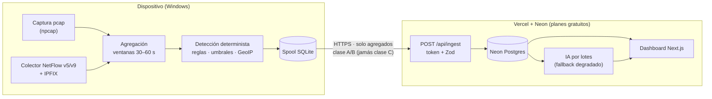
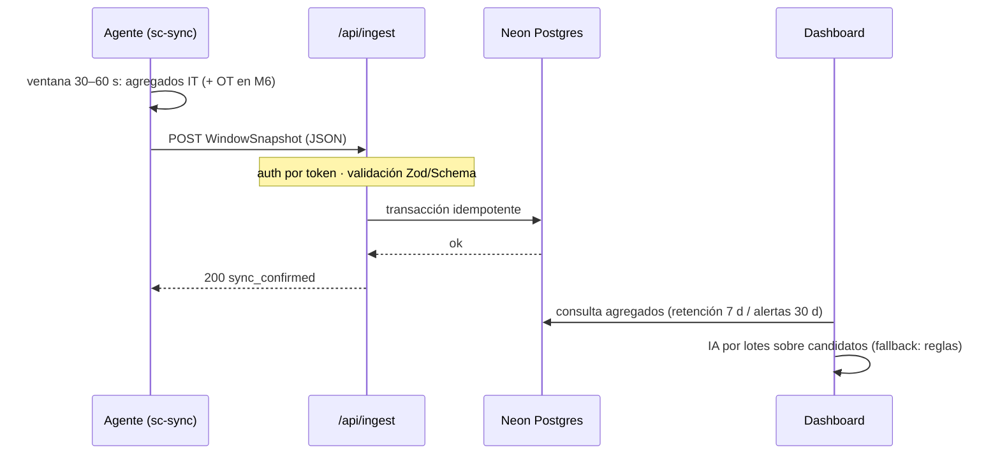

# SC-Sentinel — Strategic Connex Anomaly Shield

Monitor de red con motor determinista local + dashboard en la nube. El agente captura tráfico en el dispositivo (pcap / NetFlow), lo agrega en ventanas de 30–60 s y envía señales de métricas (NUNCA paquetes crudos) a un dashboard en Vercel. La IA actúa como asistente de interpretación; el motor determinista Servicio/umbrales/GeoIP es la fuente de verdad.

## Arquitectura

```
┌─ Dispositivo (Windows, modo estrictamente pasivo) ──────────────────────────────┐
│  captura pcap (npcap) ──┐                                                       │
│  colector NetFlow/IPFIX ┴→ agregación en ventanas 30–60 s → detección           │
│                             determinista (reglas · umbrales · blacklist · GeoIP)│
│                                        ↓                                        │
│                        spool SQLite → sync HTTPS (c/ 30 min, al arrancar)       │
└──────────────────────────────────────┬──────────────────────────────────────────┘
                                       │ WindowSnapshot (agregados IT/OT)
                                       │ NUNCA paquetes crudos · NUNCA clase C
                                       ▼
             Vercel  POST /api/ingest (token + Zod) ──→  Neon Postgres
                                                        ├→ Dashboard Next.js
                                                        ├→ IA por lotes (interpretación)
                                                        └→ Alertas webhook (Slack/Discord)
```





## Estructura

- `agent/` — workspace Rust (agente local: captura, agregación, sincronización). Ver `agent/README.md`.
- `web/` — Next.js 15 (dashboard + landing). Ver `web/README.md`.
- `docs/` — spec (fuente de verdad), ADRs, contratos, runbooks, testing. Empezar por `docs/README.md`.
- `scripts/` — despliegue, verificación, migraciones y utilidades (PowerShell / Node / Python).
- `installer/` — fuente NSIS del instalador Windows (`sc-sentinel.nsi`).
- `.github/workflows/` — CI: `rust`, `web`, `contracts`, `release`, `installer-windows`, `ai-cron`.
- `doc/` — notas sueltas de mejora; no confundir con `docs/`.
- `docs/atlas.pdf` — atlas de documentación completo en A4 vectorial (306 páginas: 91 docs + 12 diagramas SVG embebidos). Generado con Chrome headless print-to-pdf.
- `docs/diagrams/exports/` — 12 diagramas en formato vectorial: `.svg` (fuente), `.dxf` (CAD, uno por diagrama) y `.png` (3 diagramas clave). Conversión SVG→DXF vía `scripts/svg2dxf.py` (ezdxf).

## Skeleton del proyecto

```
SC-Sentinel/
├── agent/                        # Workspace Rust — ver agent/README.md
│   ├── crates/
│   │   ├── sc-agent/             # daemon + servicio Windows (src/main.rs, src/service.rs)
│   │   ├── sc-capture/           # captura de paquetes (pcap, Windows/npcap)
│   │   ├── sc-collector/         # colector pasivo NetFlow v5/v9 + IPFIX (M4)
│   │   ├── sc-aggregate/         # agregación en ventanas de 30 s
│   │   ├── sc-detect/            # motor determinista (reglas, blacklist, riesgo)
│   │   ├── sc-sync/              # spool SQLite + cliente POST /api/ingest
│   │   ├── sc-core/              # tipos de dominio (FlowKey, HostStats, WindowSnapshot)
│   │   ├── sc-config/            # configuración TOML del agente
│   │   ├── sc-geo/               # GeoIP vía MaxMindDB
│   │   ├── sc-gui/               # GUI de bandeja Windows
│   │   └── sc-telemetry/         # métricas, logs, healthcheck local
│   └── fixtures/                 # loopback-trace.pcap + 12 fixtures de firmas OT (M6 E2.0)
├── web/                          # Next.js 15 (App Router) — ver web/README.md
│   └── app/
│       ├── (marketing)/          # / · /funcionalidades · /security · /contacto
│       │                         # /novedades · /legal/{privacy,terms,third-party-notices}
│       ├── (dashboard)/dashboard/
│       │   ├── overview/  hosts/  connections/  alerts/  evals/  settings/
│       │   └── admin/            # exports/ · trust-access/
│       ├── demo/  login/  p/     # demo de solo lectura · login · Trust Pages
│       └── api/                  # 24 rutas: ingest, ai/{analyze,cron}, chat(+history),
│                                 # devices (enroll, [id], [id]/ot-assets, [id]/rotate),
│                                 # alerts/[id], export(+stats), trust(+access,[id]/rotate),
│                                 # operators, query, auth, cron/cleanup, csp-report
├── docs/                         # spec (fuente de verdad), ADRs, contratos, runbooks
│   ├── README.md                 # índice verificable de todos los directorios
│   ├── adr/                      # ADR-0001 … ADR-0022
│   ├── contracts/                # JSON Schema (window-snapshot/alert/agent-health v1)
│   │                             # + specs markdown (chat-api, ingest-api v1)
│   └── OT/                       # plan de M6 (E0–E10): identificación pasiva OT
├── scripts/                      # despliegue, verify-*, migraciones, gates de docs
├── installer/                    # fuente NSIS (sc-sentinel.nsi)
└── .github/workflows/            # CI: rust · web · contracts · release
                                  #      installer-windows · ai-cron
```

## Desarrollo local (requerido: Rust stable, Node 20+, pnpm 10+)

```bash
# Agente
cd agent && cargo test && cargo run -p sc-agent -- --version

# Web
pnpm --dir web install
pnpm --dir web dev
```

Requisitos detallados y gates diarios: `docs/runbooks/local-development.md`.

## Estatus

- M0: scaffold + CI verde. M1: captura + agregación + sync. M2: ingesta en Vercel/Neon + dashboard v0.
- **M3 (cerrado):** landing pública SSG (`/`, `/funcionalidades`, `/security`, `/contacto`, `/legal/*`), capa IA por lotes con fallback degradado (`/api/ai/analyze`, `/api/ai/cron`, panel IA), SEO/analytics y legales con sign-off. Cierre y baches abiertos: `docs/superpowers/plans/2026-11-05-m3-landing-ia-design.md` §9.
- **M3.5 (cerrado):** chatbot seguro con RAG, streaming SSE e historial. Contrato: `docs/contracts/chat-api.v1.md`; decisión: `docs/adr/0013-chatbot-mvp.md`.
- **Ruta B v2 (entregada):** export CSV/XLSX con streaming y auditoría, AI Evals con coste/latencia/éxito y Trust Pages con rotación, revocación y access logs. Runbooks y métricas en `docs/`.
- **M4 (cerrado):** colector pasivo NetFlow v5/v9 + IPFIX integrado en el agente (ADR-0014), con métricas del colector persistidas en `agent_health` y visibles en el dashboard; validado con MikroTik RouterOS CHR, fixtures reales y soak de 24 h.
- **M5 (cerrado):** servicio Windows `SC-Sentinel-Agent` con recovery, logging a archivo, instalador/desinstalador y runbook verificados en una instalación real. Reinicio real del servidor verificado el 2026-11-13 (LastBootUpTime 20:20:10 local; servicio `Running` sin arranque manual, `AUTO_START`; npcap `RUNNING`; captura live con `--interface`; `packets_seen` creciente; `sync_confirmed` posterior). GUI post-reinicio confirmada por el propietario. **Ciclo físico de 10 etapas completado el 2026-11-14 con 0 fallos** (`scripts/verify-m5-cycle.ps1`, UAC aceptado; destapó y corrigió tres defectos de instalador/desinstalador; ver `docs/testing/acceptance-criteria.md`).
- **M6 (en curso):** identificación pasiva OT (Modbus/TCP, S7comm, DNP3, IEC-104): plan por etapas en `docs/OT/` (E0–E10). Cerradas: E0–E1.5 (ADRs 0021–0022), E2.0 (fixtures de firmas), E2 (bloque `ot` en el contrato), E3 (migración `0017` `ot_assets`).
- **Releases:** primera release funcional `v0.1.0`; última publicada **`v0.1.10`** (2026-11-24, instalador NSIS). Ver `docs/release/changelog.md`.
- **Demo pública:** `/demo` entra como visitante de solo lectura, sin credenciales ni configuración previa.
- Roadmap histórico M0–M5: `docs/superpowers/specs/SC-Sentinel-Spec-Completo-2026-11-03.md` §13.
