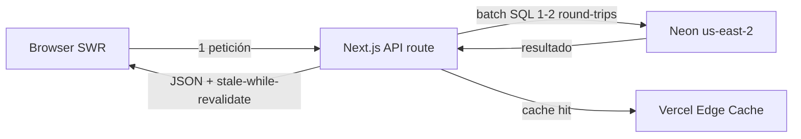

# Design Draft — Mejorar el rendimiento de las consultas Neon del dashboard Next.js

*   **Author:** EGM
*   **Status:** Draft
*   **Date:** 2026-11-23

---

## Overview

El dashboard de SC-Sentinel ejecuta entre 7 y 12 consultas SQL independientes contra Neon por cada carga de `/api/query`, usando el driver HTTP serverless (`@neondatabase/serverless` + `drizzle-orm/neon-http`). Cada consulta es una petición HTTP separada, multiplicando la latencia de round-trip y el tiempo de compute despierto en Neon. No hay caché HTTP (todo responde con `no-store`), no hay pooling (el driver HTTP es stateless por diseño), y varias consultas repiten los mismos JOINs y filtros sobre `flow_windows`/`host_stats` en la misma petición. El objetivo es reducir el tiempo de respuesta del dashboard (SLO: <500 ms p95 TTFB) y los costos de compute de Neon (CU-horas) mediante consolidación de consultas, índices compuestos y caché de corta vida en el borde.

## The Problem

El dashboard agrega datos por ventana de 30 s sobre hasta 7 días (~20k ventanas por dispositivo). Las agregaciones (SUM, COUNT DISTINCT, array_agg, DISTINCT ON) se recomputan en cada carga. El driver HTTP sin estado genera un round-trip por consulta; con 12 consultas por carga y SWR revalidando en el cliente, el número de peticiones HTTP a Neon se multiplica. Neon suspende compute tras inactividad (scale-to-zero), por lo que cada petición puede disparar cold start. La región de Neon (us-east-2) difiere de la de Vercel (iad1), añadiendo latencia. No hay baseline medido de CU-horas ni p95 TTFB por métrica, lo que impide validar cualquier mejora.

## Goals

*   Reducir el p95 TTFB de `/api/query?metric=overview` por debajo de 500 ms.
*   Reducir el número de round-trips HTTP a Neon por carga de overview de 12 a 2 o menos.
*   Agregar índices compuestos que eliminen heap fetch en agregaciones frecuentes.
*   Implementar caché de corta vida (TTL ≤ 5 min) en el borde para métricas no críticas, con clave por `device_id` y rol.
*   Medir y documentar CU-horas/mes y p95 TTFB antes y después de cada cambio.
*   Mantener `web/lib/query/__tests__` en verde (pglite) tras cualquier cambio de query.

## Non-Goals

*   No introducir servicios de pago (Redis, Upstash) ni cache layer nuevo; usar solo Vercel Edge Cache / `unstable_cache` de Next.js.
*   No modificar el contrato de ingest del agente (cambio de contrato requiere ADR aparte).
*   No migrar la región de Neon en esta fase (solo verificar y documentar; migración es decisión del propietario).
*   No optimizar prematuramente sin baseline de CU-horas.
*   No cachear en CDN público datos por device (privacidad clase B/C).

## Open Questions

*   **CU-horas/mes actual:** no disponible por CLI; verificar en Neon Console.
*   **Slow queries:** verificar en Neon Console → Query performance.
*   **Dashboard multi-device en v1:** afecta claves de caché e índices.
*   **Presupuesto de CU-horas:** ¿hay un techo que no se debe superar?
*   **Rollup en agente vs materialized view en Neon:** decisión pendiente (ADR requerido).

## Critical User Journeys (CUJs)

### CUJ 1: Carga de overview del dashboard

*   **Given**: El usuario abre el dashboard y selecciona rango de 1 h.
*   **When**: El frontend dispara `/api/query?metric=overview&range=1h`.
*   **Then**: El dashboard muestra métricas agregadas (hosts, países, ASN, alertas, series) con p95 TTFB <500 ms y datos con staleness ≤5 min.

### CUJ 2: Drill-down por host

*   **Given**: El usuario hace clic en un host del top hosts.
*   **When**: El frontend dispara `/api/query?metric=host-detail&host_key=...`.
*   **Then**: Se muestran detalles del host (bytes, paquetes, risk score) sin recalcular todo el overview.

### CUJ 3: Exportación de datos

*   **Given**: El usuario solicita exportación de 30 días.
*   **When**: El frontend dispara `/api/export?range=30d`.
*   **Then**: El archivo se genera sin timeout en Vercel y con streaming en lotes de 500.

## Technical Plan (Architecture)

### Arquitectura actual

```
Browser (SWR) → Next.js API route (/api/query) → drizzle-orm/neon-http → @neondatabase/serverless (HTTP) → Neon (us-east-2)
```

Cada métrica dispara una o más consultas SQL. `queryOverview` lanza 12 consultas en `Promise.all`. El driver HTTP es stateless: cada `.execute()` es una petición HTTP independiente.

### Cambios propuestos

1. **Consolidación de queries (round-trips):** Reescribir `queryOverview` para ejecutar las 12 agregaciones en 1-2 llamadas HTTP usando multi-statement o CTEs en una sola invocación del driver `neon`. Verificar compatibilidad con `drizzle-orm/neon-http`; si no, usar `@neondatabase/serverless` directamente para el batch.

2. **Índices compuestos (migración aditiva):**
   - `host_stats`: `(window_id, host_key)` — covering para agregación por host.
   - `alerts`: `(window_id, severity)` — para filtro por ventana + severidad en overview.
   - `agent_health`: `(device_id, recorded_at DESC)` — para `queryHealth` (último registro).
   - `flow_windows`: evaluar INCLUDE de columnas agregadas para evitar heap fetch.

3. **Caché en borde (stale-while-revalidate):**
   - TTL por métrica: overview 5 min (acordado), hosts 60 s, alerts 15 s, health 60 s.
   - Clave de caché: `{metric}:{device_id}:{range}:{role}` para evitar fuga entre devices.
   - Implementar con `unstable_cache` de Next.js o Vercel Edge Cache con `revalidate`.
   - Invalidar por evento de sync (el agente envía cada 30 min; el dashboard puede forzar refresh).

4. **SWR dedup en cliente:** Usar keys de SWR para evitar peticiones duplicadas en cambios de rango.

5. **Mover `attachHostnames` fuera del path crítico:** Ejecutar DNS inverso en background o cachear resultados.

### Flujo de datos (propuesto)



### Componentes afectados

- `web/lib/db/index.ts` — proxy de conexión (evaluar instancia singleton).
- `web/lib/query/overview.ts` — consolidación de 12 queries.
- `web/lib/query/db-rows.ts` — soporte multi-statement.
- `web/lib/query/range.ts` — sin cambios (bucketing ya optimizado).
- `web/app/api/query/route.ts` — headers de caché, ETag/Last-Modified.
- `web/lib/db/schema.ts` + migraciones — nuevos índices.
- `web/lib/swr.ts` — dedup de claves.

---

## Alternatives Considered

### Alternative A: Materialized views en Neon

*   **Pros**: Evita CTE costosos en runtime; refresh concurrente.
*   **Cons**: Requiere migración de datos y refresh programado; mayor complejidad operativa.
*   **Reason for Rejection**: Diferido hasta medir CU-horas; prioridad menor que índices y consolidación.

### Alternative B: Rollup horario en el agente

*   **Pros**: Reduce filas en Neon y storage (1.2 GB/año → menos); ataca el problema en origen.
*   **Cons**: Cambio de contrato de ingest; mayor esfuerzo; requiere ADR.
*   **Reason for Rejection**: Alto riesgo y esfuerzo; se evaluará en fase posterior.

### Alternative C: Migrar región de Neon a iad1

*   **Pros**: Elimina latencia de red entre Vercel y Neon.
*   **Cons**: Migración de proyecto Neon; costo y riesgo; decisión del propietario.
*   **Reason for Rejection**: No es optimización de query; se verifica primero, se decide después.

## Non-Functional Requirements

*   **Performance & Latency:** p95 TTFB <500 ms para overview; TTFB de `/api/query` (sin auth) actual 0,54 s ya cerca del límite.
*   **Security & Privacy:** Clave de caché debe incluir `device_id` y rol; no cachear en CDN público datos por device (clase B/C).
*   **Rollout & Rollback:** Migraciones aditivas (índices) son seguras y no se revierten; rollback a build anterior de Vercel.
*   **Cost:** Medir CU-horas antes/después de cada cambio; no superar el free tier de Neon.

---

## Detailed Implementation Plan

### Target Files to Create/Modify

#### 1. `web/lib/db/schema.ts` (Modify)
*   **Type / Scope:** Drizzle schema definition
*   **Proposed Changes:** Agregar índices compuestos: `host_stats (window_id, host_key)`, `alerts (window_id, severity)`, `agent_health (device_id, recorded_at DESC)`.

#### 2. `web/lib/db/migrations/0017_perf-indexes.sql` (Create)
*   **Type / Scope:** Migración aditiva
*   **Proposed Changes:** `CREATE INDEX CONCURRENTLY` para los 3 índices compuestos. Probar en rama de Neon antes de aplicar en producción.

#### 3. `web/lib/query/overview.ts` (Modify)
*   **Type / Scope:** Query module
*   **Proposed Changes:** Reescribir `queryOverview` para consolidar las 12 consultas en 1-2 round-trips HTTP usando multi-statement o CTEs. Mantener la misma firma de retorno para no romper el route handler.

#### 4. `web/lib/query/db-rows.ts` (Modify)
*   **Type / Scope:** Query executor
*   **Proposed Changes:** Agregar soporte para multi-statement en una sola llamada HTTP del driver `neon`.

#### 5. `web/app/api/query/route.ts` (Modify)
*   **Type / Scope:** API route handler
*   **Proposed Changes:** Agregar headers de caché (`Cache-Control: s-maxage=300, stale-while-revalidate=60` para overview; 60s para hosts; 15s para alerts; 60s para health). Incluir `ETag`/`Last-Modified` basado en `max(updated_at)`.

#### 6. `web/lib/cache/` (Create)
*   **Type / Scope:** Cache helper (nuevo directorio)
*   **Proposed Changes:** Wrapper con `unstable_cache` de Next.js, clave por `{metric}:{device_id}:{range}:{role}`.

#### 7. `web/lib/swr.ts` (Modify)
*   **Type / Scope:** Client-side SWR config
*   **Proposed Changes:** Dedup de claves para evitar peticiones duplicadas en cambios de rango.

#### 8. `web/lib/query/__tests__/` (Modify)
*   **Type / Scope:** Tests pglite
*   **Proposed Changes:** Actualizar tests de overview para reflejar la consolidación; mantener cobertura.

#### 9. `docs/adr/00XX-neon-query-performance.md` (Create)
*   **Type / Scope:** ADR
*   **Proposed Changes:** Documentar estrategia de caché, consolidación e índices. Número siguiente libre (verificar `docs/adr`).

#### 10. `docs/operations/slo.md` (Modify)
*   **Type / Scope:** SLO doc
*   **Proposed Changes:** Agregar SLI de CU-horas y p95 por métrica.

### Verification Plan

*   **Compilation/Build:** `pnpm typecheck`, `pnpm lint`, `pnpm build`
*   **Unit Tests:** `pnpm test` (Vitest + pglite) — todos los tests de `web/lib/query/__tests__` deben pasar.
*   **Static Analysis:** `pnpm lint`
*   **Migration Test:** Aplicar migración en rama de Neon; verificar con `EXPLAIN ANALYZE` que los nuevos índices se usan.
*   **Performance:** Medir p95 TTFB de `/api/query?metric=overview` antes y después; medir CU-horas en Neon Console.
*   **Cache Verification:** Verificar headers `Cache-Control` y `ETag` en respuestas; verificar que datos stale no excedan 5 min.

---

*Drafted with EGM*