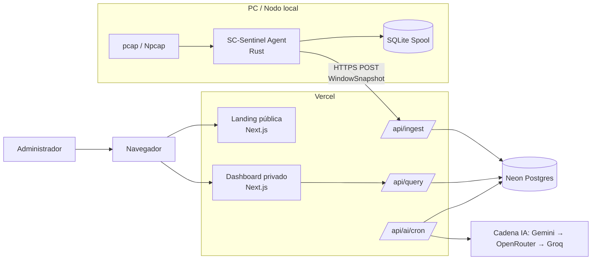
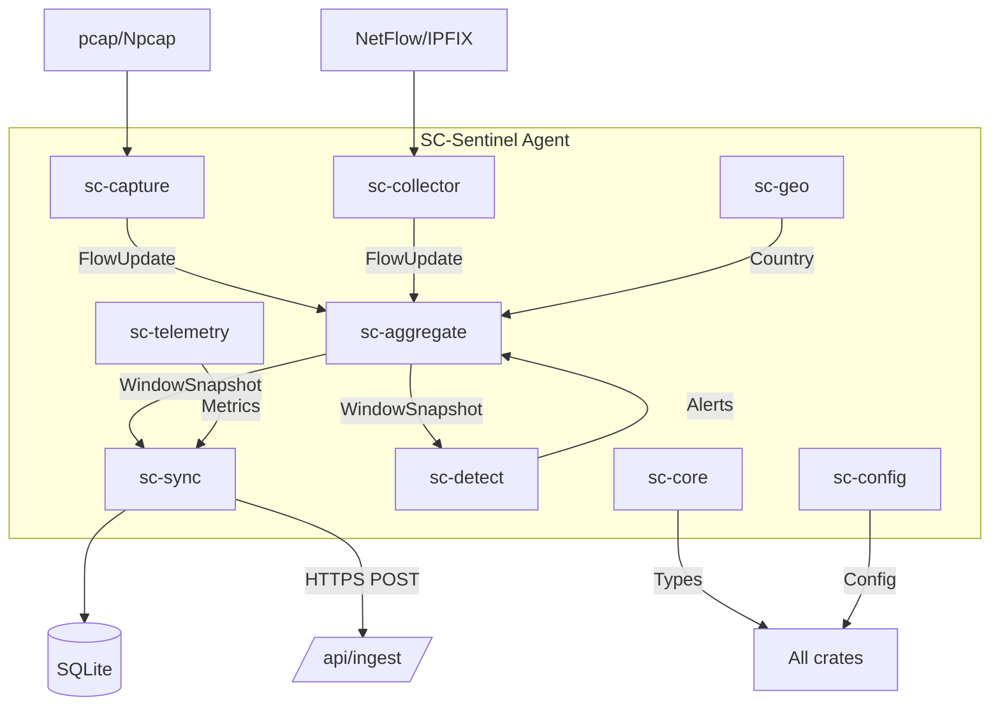
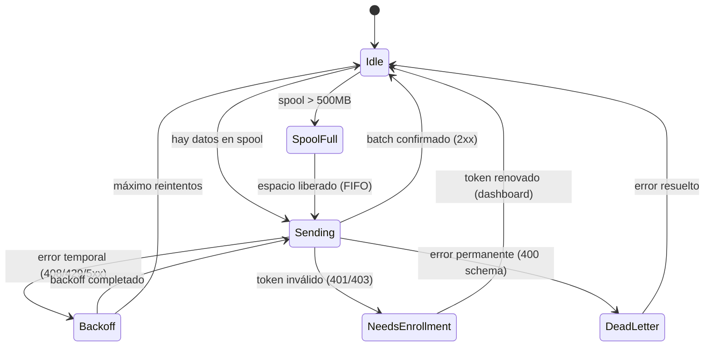

# SC-Sentinel — Especificación Completa de Diseño

**Proyecto:** Strategic Connex Anomaly Shield
**Repositorio:** SC-Sentinel
**Fecha:** 2026-11-03
**Estado:** Aprobado por el propietario (Spec completo v2.2 — consolidación IA free-tier)
**Propiedad:** Strategic Connex — software PROPIETARIO

> v2.2 (2026-11-08) = consolidación IA free-tier: cron de IA a 15 min vía GitHub Actions, cadena multi-proveedor Gemini → OpenRouter → Groq, modelos Gemini 3.6/3.5 Flash, presupuesto diario `AI_DAILY_CALL_BUDGET`, cooldown 429 + backoff 5xx 1 s/2 s, logging estructurado y respuesta máxima a 4.000 tokens. Ver Apéndice C.
> v2.1 = v2.0 normalizado: se restauró la estructura Markdown (headers, tablas, code fences), se eliminó un bloque duplicado, se resolvieron 6 contradicciones internas y se definieron contratos faltantes (enrollment, AI analyze, duplicados idempotentes, rate-limit de drenaje, plan B de cron). Ver Apéndice C.

---

## Tabla de Contenidos

1. [Qué es](#1-qué-es)
2. [Base de datos elegida](#2-base-de-datos-elegida)
3. [Decisiones registradas (ADR)](#3-decisiones-registradas-adr)
4. [Estructura del repositorio](#4-estructura-del-repositorio)
5. [Contratos formales](#5-contratos-formales)
6. [Modelo de datos](#6-modelo-de-datos)
7. [Flujo de datos](#7-flujo-de-datos)
8. [Errores y resiliencia](#8-errores-y-resiliencia)
9. [Seguridad y threat model](#9-seguridad-y-threat-model)
10. [Observabilidad del agente](#10-observabilidad-del-agente)
11. [IA: política y contratos](#11-ia-política-y-contratos)
12. [Retención y sizing](#12-retención-y-sizing)
13. [Instalación y operación](#13-instalación-y-operación)
14. [Testing y criterios de aceptación](#14-testing-y-criterios-de-aceptación)
15. [CI/CD y releases](#15-cicd-y-releases)
16. [Frameworks y librerías](#16-frameworks-y-librerías)
17. [Documentación y diagramas](#17-documentación-y-diagramas)
18. [UX: Landing y Dashboard](#18-ux-landing-y-dashboard)
19. [Hitos](#19-hitos)
20. [Dominios y Nomenclatura](#20-dominios-y-nomenclatura)
21. [Fuera de alcance (v1)](#21-fuera-de-alcance-v1)
- [Apéndice A: Glosario](#apéndice-a-glosario)
- [Apéndice B: Referencias](#apéndice-b-referencias)
- [Apéndice C: Changelog del spec](#apéndice-c-changelog-del-spec)

---

## 1. Qué es

Strategic Connex Anomaly Shield (SC-Sentinel) es un sistema de monitoreo y detección de anomalías de red en dos partes:

- **Agent local (Rust)** — corre en la PC/nodo; captura tráfico (pcap) y/o recibe NetFlow v9/IPFIX; pre-agrega ventanas de 30–60 s y publica snapshots HTTPS a la nube.
- **Nube (Next.js + Vercel)** — landing pública + dashboard privado con overview, hosts, conexiones, alertas y panel de análisis IA (modelos free: Gemini → OpenRouter → Groq).

**Principio rector:** el motor determinista (parser etherparse, tablas de ~6000 servicios, GeoIP MaxMind) SIEMPRE corre y es la fuente de verdad. La IA enriquece con análisis por lotes, nunca reemplaza al motor y nunca opera por-flujo.

---

## 2. Base de datos elegida

**Neon Postgres free tier.**

**Motivos:**

- Sinergia nativa serverless-Vercel (driver HTTP, misma región).
- Autosuspend no borra datos; agente offline semanas no rompe la DB.
- Branching para preview deployments de Vercel.
- Capacidad 0.5 GB es suficiente con política de retención estricta (~22 MB/día según §12.2, ~250 MB totales proyectados).

**Consideraciones:**

- Requiere cleanup agresivo y control de cardinalidad (caps de §12.3).
- No se almacenarán raw packets ni flujos individuales.
- Si el volumen crece, reevaluar TimescaleDB o ClickHouse.

---

## 3. Decisiones registradas (ADR)

| Tema | Decisión |
|------|----------|
| Arquitectura | Extracción limpia (Opción B) — crates nuevos desde día 1; NO fork in place |
| Fuente primaria | PC local vía pcap (M1/M2) |
| Fuentes secundarias | MikroTik RouterOS v7 IPFIX y Cisco NetFlow v9 vía collector heredado (M4) |
| Binarios | Ambos: `sc-sentinel` (GUI iced, híbrido posterior) + `sc-sentinel-agent` (daemon headless) |
| Audiencia dashboard | Uso interno (single-device, no multi-tenant) |
| Licencia | Propietaria Strategic Connex; módulos extraídos de Sniffnet quedan con headers MIT/Apache-2.0 + `THIRD_PARTY_NOTICES.md`; sin marca "Sniffnet" en superficies de usuario |
| Identidad visual | Design tokens extraídos de strategicconnex.com.ar |
| DB | Neon Postgres free |
| IA | Modelos free de Gemini, OpenRouter (`:free`) y Groq con cadena de fallback multi-proveedor; batch ≤1 llamada/15 min |
| Paleta realtime | SWR polling 5 s (no websockets) |
| Idempotencia | `UNIQUE(device_id, window_id)`; duplicado → 200 `{status:"duplicate"}`, nunca error ni doble métrica |
| Compresión | **gzip con soporte obligatorio; zstd opcional recomendado (deshabilitado por defecto en v1)** — descompresión SIEMPRE explícita en el route (ADR-0009) |
| Auth agente | Bearer token hasheado SHA-256 en DB |
| Auth dashboard | Cookie HttpOnly + sesión firmada |
| Enrollment/rotación | Manual, administrado desde el dashboard Settings — sin endpoints pre-autenticados (ADR-0010) |
| Rate limit | Token bucket 60 req/min por device (burst 30) — dimensionado para drenar spool tras reconexión (ADR-0011) |
| Dominio | Oficial `sc-sentinel.vercel.app` (ADR-0012) |
| Styling web | Tailwind v4 CSS-first (`@theme` en `globals.css`, tokens como CSS variables; sin `tailwind.config.js`) |

Detalle de ADRs en `docs/adr/` (se crean en M0): 0001-monorepo, 0002-rust-agent, 0003-neon-postgres-free, 0004-swr-instead-of-websockets, 0005-ai-batch-only, 0006-sniffnet-extraction, 0007-single-device-v1, 0008-idempotency, 0009-compresion-gzip-zstd, 0010-enrollment-dashboard-manual, 0011-rate-limit-drain, 0012-dominio-oficial.

---

## 4. Estructura del repositorio

```text
D:\ProyectosWeb\SC-Sentinel\
├── agent/                          # workspace Rust
│   ├── crates/
│   │   ├── sc-core/                # tipos dominio: FlowKey, HostStats, Alert, WindowSnapshot
│   │   ├── sc-capture/             # motor pcap (de networking/{capture,parse_packets,manage_packets}.rs)
│   │   ├── sc-collector/           # NetFlow v9/IPFIX (de networking/ipfix/*)
│   │   ├── sc-geo/                 # MaxMind wrapper (de mmdb/)
│   │   ├── sc-detect/              # motor determinista: servicios, baseline, blacklist, umbrales
│   │   ├── sc-aggregate/           # ventana 30–60 s → WindowSnapshot (~2–10 KB JSON)
│   │   ├── sc-sync/                # HTTPS POST + device-token + spool SQLite (reintentos, cota 500 MB/7 días FIFO)
│   │   ├── sc-config/              # gestión config TOML + hot-reload
│   │   ├── sc-telemetry/           # métricas internas del agente
│   │   ├── sc-agent/               # bin daemon headless (servicio Windows, config TOML)
│   │   └── sc-gui/                 # bin GUI iced (M5/híbrido)
│   ├── Cargo.toml
│   └── README.md
│
├── web/                            # Next.js 15, TS, Vercel
│   ├── app/
│   │   ├── (marketing)/            # "/", /funcionalidades, /contacto — SSG público
│   │   ├── (dashboard)/            # /dashboard/* — protegido (middleware + cookie admin)
│   │   │   └── dashboard/
│   │   │       ├── overview/
│   │   │       ├── hosts/
│   │   │       ├── connections/
│   │   │       ├── alerts/
│   │   │       ├── ai/
│   │   │       └── settings/
│   │   └── api/                    # /ingest /query /ai/analyze /ai/cron /cron/cleanup
│   ├── components/
│   │   ├── ui/                     # shadcn/ui (compartido)
│   │   ├── marketing/              # Hero, Features, Pricing
│   │   └── dashboard/              # Charts, Tables, Sidebar
│   ├── lib/
│   │   ├── db.ts                   # Drizzle + Neon
│   │   ├── auth.ts                 # Auth logic (cookie admin + device token)
│   │   └── schemas/                # Zod contracts
│   ├── content/                    # MDX para docs/blog
│   ├── public/
│   │   └── og/                     # Open Graph images
│   ├── middleware.ts               # Auth check
│   ├── next.config.js
│   └── package.json
│
└── docs/
    ├── README.md
    ├── specs/
    │   ├── SC-Sentinel-Spec-Completo-2026-11-03.md   (este archivo — fuente de verdad)
    │   └── archive/2026-11-02-sc-sentinel-design.md  (v1.0 — superseded)
    ├── adr/            # 0001..0012 (lista en §3)
    ├── contracts/
    │   ├── ingest-api.v1.md
    │   ├── window-snapshot.v1.schema.json
    │   ├── alert.v1.schema.json
    │   ├── agent-health.v1.schema.json
    │   └── examples/
    │       ├── ingest-request.valid.json
    │       ├── ingest-request.invalid.json
    │       ├── snapshot-minimal.json
    │       └── snapshot-with-alerts.json
    ├── diagrams/
    │   ├── mermaid/    # system-context, agent-components, ingest-sequence,
    │   │               # sync-state-machine, database-erd, ai-cron-sequence, alert-lifecycle
    │   ├── drawio/     # deployment-vercel-neon, topología pcap, topología ipfix, layout servicio Windows
    │   └── exports/    # svg/pdf generados de los anteriores
    ├── runbooks/
    │   ├── local-development.md
    │   ├── install-agent-windows.md
    │   ├── install-agent-linux.md
    │   ├── troubleshoot-pcap.md
    │   ├── troubleshoot-sync.md
    │   ├── rotate-device-token.md
    │   ├── database-cleanup.md
    │   └── incident-response.md
    ├── testing/        # test-plan, acceptance-criteria, fixtures, release-checklist
    ├── ux/             # landing-sitemap, dashboard-wireframes, design-tokens, copywriting
    ├── legal/          # THIRD_PARTY_NOTICES, maxmind-notice, npcap-notice, privacy-policy-draft, terms-draft
    └── release/        # versioning, changelog, signing, deployment
```

### 4.1 Interfaces entre crates

```text
sc-capture   → canal tokio mpsc de FlowUpdate hacia sc-aggregate (bounded, backpressure §8.2)
sc-aggregate → WindowSnapshot (JSON versionado, campo v) hacia sc-sync
sc-sync      → POST /api/ingest con payload {device, window, snapshot} (§5.1)
web          → consume solo /api/ingest (escritura) y /api/query (lectura dashboard)
```

**Extracción clave:** el único refactor difícil es desacoplar iced de la lógica de captura (mensajes iced → eventos tokio). `ipfix/` es ya autónomo (~95% reutilizable). ~90% de capture se reutiliza.

---

## 5. Contratos formales

### 5.1 API de ingesta `/api/ingest`

**Método:** POST

**Headers:**

```http
Authorization: Bearer <device-token>
Content-Type: application/json
Content-Encoding: gzip | zstd        (opcional; el servidor descomprime en el route)
```

**Payload:**

```json
{
  "v": 1,
  "device": {
    "id": "dev_01HXYZ...",
    "agent_version": "0.1.0",
    "hostname": "pc-office",
    "boot_id": "uuid-boot-123"
  },
  "window": {
    "id": "win_01HXYZ...",
    "start": "2026-11-03T12:00:00Z",
    "end": "2026-11-03T12:00:30Z",
    "duration_ms": 30000,
    "sequence": 1234
  },
  "snapshot": {
    "top_hosts": [
      {
        "host_key": "hmac-truncated",
        "ip_display": null,
        "country": "AR",
        "bytes_in": 1048576,
        "bytes_out": 524288,
        "packets": 1500,
        "risk_score": 0.2
      }
    ],
    "top_ports": [
      { "port": 443, "protocol": "tcp", "bytes": 2097152, "connections": 50 }
    ],
    "top_countries": [
      { "country": "AR", "bytes": 5242880, "hosts": 15 }
    ],
    "alerts": [
      {
        "rule_id": "dns_tunneling",
        "severity": "high",
        "title": "Posible túnel DNS detectado",
        "description": "Volumen anómalo de queries DNS a dominio externo",
        "evidence": {
          "domain": "example.com",
          "query_count": 500,
          "window": "2026-11-03T12:00:00Z/2026-11-03T12:00:30Z"
        }
      }
    ],
    "health": {
      "capture_status": "ok",
      "packets_seen": 50000,
      "packets_dropped": 0,
      "parse_errors": 0,
      "queue_depth": 5,
      "spool_bytes": 102400,
      "cpu_percent": 2.5,
      "memory_bytes": 52428800
    }
  }
}
```

> **Regla de privacidad:** cuando `anonymize_hosts = true` (config del agente), `ip_display` se envía **null** — la IP real nunca sale del nodo local; `host_key` (HMAC truncado) es el único identificador persistente.

**Respuestas:**

| Código | Significado | Acción del agente |
|--------|-------------|-------------------|
| 200 `{status:"processed"}` | batch confirmado | batch eliminado del spool |
| 200 `{status:"duplicate"}` | `(device_id, window_id)` ya procesado | batch eliminado del spool (idempotente, nunca es error) |
| 400 | schema inválido | batch movido a dead_letter local |
| 401 | token inválido/desconocido | estado `needs_enrollment` |
| 403 | token expirado o revocado | estado `needs_enrollment` |
| 408 | timeout | reintento con backoff |
| 413 | payload too large | batch dividido (si es posible) o dead_letter |
| 429 | rate limit | reintento con backoff |
| 5xx | error del servidor | reintento con backoff |

**Idempotencia:**

- Clave única: `UNIQUE(device_id, window_id)` en DB (§6).
- Insert con `ON CONFLICT DO NOTHING`: un reenvío del mismo window devuelve `200 {status:"duplicate"}` — nunca duplica métricas ni falla.
- Auditoría de duplicados: `ingest_batches.payload_hash` permite verificar si el reenvío era idéntico.

**Límites:**

- Payload máximo comprimido: 128 KB; sin comprimir: 512 KB.
- `top_hosts` ≤ 50; `top_ports` ≤ 50; `top_countries` ≤ 30; `alerts` ≤ 50 por ventana.

**Rate limit (ADR-0011):**

- Token bucket por device: **60 req/min, burst 30** (suficiente para que un agente que reconecta drene su spool en minutos, no horas).
- Anti-abuse global: por IP desconocida (sin token válido) 20 req/min y respuesta 401.
- Excede → 429 con `Retry-After`.

### 5.2 API de consulta `/api/query`

**Método:** GET — **Auth:** `Cookie: sc_session=<session-token>` (dashboard).

**Query params:** `range: 1h | 6h | 24h | 7d`, `metric: overview | hosts | alerts | ai`.

**Respuesta:** JSON con datos agregados según métrica (shapes en `docs/contracts/`).

### 5.3 API de análisis IA bajo demanda `/api/ai/analyze`

**Método:** POST — **Auth:** `Cookie: sc_session`.

- Dispara el mismo pipeline que el cron de IA (§11.3) para el lote más reciente aún no analizado.
- Respeta el gate: si pasó un análisis < 5 min, devuelve el insight cacheado con `200 {cached:true}` — nunca re-analiza los mismos hechos (dedup por `facts_hash`).
- Ese gate de 5 min protege solo contra pedidos on-demand repetidos; el cron de 15 min (§11.3) tiene su propio early-return por ventanas nuevas y no depende de esta ventana.
- Si la cadena de fallback agotó modelos: `200 {status:"degraded"}` (no error).

### 5.4 Endpoints de cron y secretos

```http
POST /api/ai/cron        Header: x-cron-secret: <CRON_SECRET>
POST /api/cron/cleanup   Header: x-cron-secret: <CRON_SECRET>
```

- Invocados por cron externo: GitHub Actions (`.github/workflows/ai-cron.yml`) dispara `POST /api/ai/cron` cada 15 min con header `x-cron-secret` (Vercel Cron solo cubre `/api/cron/cleanup`: el plan Hobby no garantiza intervalos cortos). `CRON_SECRET` vive solo en env de servidor Vercel.
- `/api/cron/cleanup` corre diario 03:00 UTC (retención §12).

---

## 6. Modelo de datos

### 6.1 Tablas principales

```sql
-- Dispositivos registrados
CREATE TABLE devices (
    id TEXT PRIMARY KEY,
    name TEXT NOT NULL,
    token_hash TEXT NOT NULL,                -- SHA-256 del token; plaintext solo visible al crear
    token_created_at TIMESTAMPTZ NOT NULL,
    token_rotated_at TIMESTAMPTZ,
    agent_version TEXT,
    last_seen_at TIMESTAMPTZ,
    status TEXT NOT NULL DEFAULT 'active',   -- active | enrolled_pending | revoked
    created_at TIMESTAMPTZ NOT NULL DEFAULT NOW()
);

-- Ventanas de flujo agregadas
CREATE TABLE flow_windows (
    id TEXT PRIMARY KEY,                     -- window_id del payload
    device_id TEXT NOT NULL REFERENCES devices(id),
    window_start TIMESTAMPTZ NOT NULL,
    window_end TIMESTAMPTZ NOT NULL,
    duration_ms INTEGER NOT NULL,
    bytes_in BIGINT NOT NULL,
    bytes_out BIGINT NOT NULL,
    packets_in BIGINT NOT NULL,
    packets_out BIGINT NOT NULL,
    snapshot_json JSONB NOT NULL,            -- top hosts/ports/countries/alerts/health (fuente de queries agregadas)
    created_at TIMESTAMPTZ NOT NULL DEFAULT NOW(),
    UNIQUE(device_id, window_start),         -- idempotencia nivel tabla
    UNIQUE(device_id, id)                    -- idempotencia por window_id
);

-- Alertas detectadas (descompuestas de snapshot_json para queries y ciclo de vida)
CREATE TABLE alerts (
    id TEXT PRIMARY KEY,
    device_id TEXT NOT NULL REFERENCES devices(id),
    window_id TEXT NOT NULL REFERENCES flow_windows(id),
    rule_id TEXT NOT NULL,
    severity TEXT NOT NULL,
    title TEXT NOT NULL,
    description TEXT,
    evidence_json JSONB,
    status TEXT NOT NULL DEFAULT 'open',     -- open | acknowledged | resolved
    created_at TIMESTAMPTZ NOT NULL DEFAULT NOW()
);

-- Salud del agente
CREATE TABLE agent_health (
    id TEXT PRIMARY KEY,
    device_id TEXT NOT NULL REFERENCES devices(id),
    window_id TEXT NOT NULL REFERENCES flow_windows(id),
    capture_status TEXT NOT NULL,
    packets_seen BIGINT NOT NULL,
    packets_dropped BIGINT NOT NULL,
    parse_errors BIGINT NOT NULL,
    queue_depth INTEGER,
    spool_bytes BIGINT,
    cpu_percent REAL,
    memory_bytes BIGINT,
    last_error TEXT,
    created_at TIMESTAMPTZ NOT NULL DEFAULT NOW()
);

-- Insights de IA
CREATE TABLE ai_insights (
    id TEXT PRIMARY KEY,
    device_id TEXT NOT NULL REFERENCES devices(id),
    period_start TIMESTAMPTZ NOT NULL,
    period_end TIMESTAMPTZ NOT NULL,
    model TEXT NOT NULL,
    status TEXT NOT NULL,                    -- ok | degraded
    risk_level TEXT,                         -- §11.2: low | medium | high | critical (null solo en filas previas a 0002)
    summary TEXT,
    recommendations_json JSONB,
    facts_hash TEXT NOT NULL,                -- deduplicación: no re-analizar mismos hechos
    created_at TIMESTAMPTZ NOT NULL DEFAULT NOW()
);

-- Ledger de idempotencia (sin FK por diseño: es un registro independiente del lote, auditable)
CREATE TABLE ingest_batches (
    id TEXT PRIMARY KEY,
    device_id TEXT NOT NULL,
    window_id TEXT NOT NULL,
    payload_hash TEXT NOT NULL,
    received_at TIMESTAMPTZ NOT NULL DEFAULT NOW(),
    schema_version INTEGER NOT NULL,
    status TEXT NOT NULL DEFAULT 'processed', -- processed | duplicate
    UNIQUE(device_id, window_id)
);

-- Configuración global (anonymize, mode IA, etc.)
CREATE TABLE settings (
    key TEXT PRIMARY KEY,
    value JSONB NOT NULL,
    updated_at TIMESTAMPTZ NOT NULL DEFAULT NOW()
);
```

> Nota: la descomposición `flow_windows.snapshot_json` + tablas `alerts`/`agent_health`/`host_stats-precalculo` es redundancia **intencional para velocidad de query** (el snapshot es la verdad, las tablas derivadas índices vivos). El sizing de §12 ya lo contempla.

### 6.2 Índices

```sql
CREATE INDEX idx_flow_windows_device_time ON flow_windows(device_id, window_start DESC);
CREATE INDEX idx_alerts_device_time       ON alerts(device_id, created_at DESC);
CREATE INDEX idx_ai_insights_device_time  ON ai_insights(device_id, created_at DESC);
CREATE INDEX idx_agent_health_device_time ON agent_health(device_id, created_at DESC);
```

---

## 7. Flujo de datos

```mermaid
flowchart LR
    PC[PC / Nodo local] -->|pcap| Capture[sc-capture]
    Capture -->|FlowUpdate<br/>tokio mpsc| Aggregate[sc-aggregate]
    Aggregate -->|WindowSnapshot<br/>30-60s| Sync[sc-sync]
    Sync -->|spool SQLite| Spool[(SQLite Spool)]
    Sync -->|HTTPS POST<br/>gzip/zstd| Ingest[/api/ingest/]

    subgraph Vercel
        Ingest -->|zod validate<br/>token auth| Neon[(Neon Postgres)]
        Query[/api/query/] --> Neon
        Dashboard[Dashboard<br/>SWR 5s] --> Query
        AICron[/api/ai/cron<br/>cada 15 min] --> Neon
        AICron -->|hechos agregados| Providers[Cadena IA<br/>Gemini → OpenRouter → Groq]
    end

    Dashboard -->|GET /api/query| Query
```

**Reglas:**

- El snapshot contiene SOLO señales agregadas (top hosts/puertos/países, picos, alertas); nunca raw packets ni flujos individuales.
- Máximo 1 llamada IA por lote de ~15 min; si hay una en curso se cancela la siguiente (sin colas).
- Si la IA no está disponible permanentemente, el sistema funciona 100% determinista (`ai_status=degraded`).

---

## 8. Errores y resiliencia

### 8.1 Política de errores de sincronización

| Fallo | Comportamiento |
|-------|----------------|
| pcap sin privilegios / crash | backoff exponencial (1→60 s) + estado de salud en log local |
| Sin internet | spool local con cota 500 MB / 7 días FIFO; vaciado en batches al reconectar (drena a ~60 req/min, §5.1) |
| 2xx del POST | batch confirmado y eliminado del spool |
| 408 / 429 / 5xx | reintento con backoff exponencial y jitter |
| 401 / 403 | estado `needs_enrollment`; se conserva spool, no se reintenta indefinidamente |
| 400 por schema inválido | batch se mueve a dead_letter local; se reporta error de contrato |
| 413 payload too large | batch se divide si es posible; si no, dead_letter |
| Spool lleno o antigüedad > 7 días | FIFO controlado, registrando `data_loss_bytes` y `data_loss_windows` |
| Token inválido | flag `needs_enrollment`; spool conservado |
| Límite de cuota free (Gemini/OpenRouter/Groq) | cooldown por proveedor (429 + `Retry-After`) + cadena de fallback; presupuesto diario opcional `AI_DAILY_CALL_BUDGET`; agotado → modo determinista puro |
| DB fría (Neon cold start) | ~1 s de latencia tolerable; el agente reintenta |

**Regla crítica:** nunca se descartan silenciosamente datos: toda pérdida debe quedar reflejada en salud del agente.

### 8.2 Backpressure en captura

- Canal tokio mpsc con límite (10.000 mensajes).
- Si se llena, se descartan paquetes y se incrementa `packets_dropped`.
- Métrica visible en dashboard: "X paquetes descartados en última ventana".

### 8.3 Compresión (ADR-0009)

- El servidor soporta **gzip y zstd**; el cliente agente elige por config.
- **v1: gzip por defecto.** Razón: zlib viene con el runtime Node (descompresión garantizada dentro del route, sin depender de comportamientos del edge/plataforma), y a los tamaños de snapshot (2–10 KB) la diferencia con zstd es marginal.
- **zstd: opcional recomendado, flag cerrado en v1.** Descompresión en-route con `fzstd` (JS puro, solo descompresión). Pasará a ser default en M2+ si hay medición que lo justifique.
- La descompresión SIEMPRE la hace el route explícitamente. El contrato no confía en transporte transparente.

---

## 9. Seguridad y threat model

### 9.1 Activos protegidos

Token del agente · tráfico agregado · IPs LAN · API keys de IA (Gemini/OpenRouter/Groq) · cookie admin · base Neon.

### 9.2 Amenazas y mitigaciones

| Amenaza | Mitigación |
|---------|------------|
| Robo de device-token | Guardar hash SHA-256, rotación, permisos locales restrictivos |
| Replay de batches | Idempotencia `UNIQUE(device_id, window_id)` + 200 duplicate |
| Payload malicioso grande | Límites de tamaño + validación zod |
| Spam a /api/ingest | Rate limit por device (60/min burst 30) y por IP sin token (20/min 401) |
| XSS en dashboard | Escape React, sanitizar contenido IA |
| Prompt injection en IA | IA recibe hechos estructurados, no instrucciones del tráfico |
| Exposición de IPs LAN | `anonymize_hosts` (HMAC truncado + `ip_display: null`) |
| DB llena | Cleanup + alertas de capacidad (>400 MB) |
| Token en logs | Redacción obligatoria en todos los logs |
| API key expuesta | Solo en env server-side de Vercel |
| Spool SQLite robado del disco | v1: snapshots solo agregados + IP real nunca sale del nodo; post-v1: cifrado DPAPI opcional |

### 9.3 Reglas de logging

**Nunca loggear:**

- device-token completo
- header Authorization
- `OPENROUTER_API_KEY`
- raw packets
- payloads completos en producción

**Sí loggear:**

- hash de token (primeros 8 caracteres)
- metadata de request (device_id, window_id, timestamp)
- errores de validación (sin payload)
- métricas de salud

### 9.4 Configuración segura (ejemplo config.toml)

```toml
[agent]
device_id = "dev_01HXYZ..."
token = "sk-..."                # en producción se lee de variable de entorno (SC_SENTINEL_TOKEN)
endpoint = "https://sc-sentinel.vercel.app/api/ingest"
window_seconds = 30
compression = "gzip"            # gzip | zstd

[capture]
interface = "auto"
promiscuous = false
snaplen = 1500

[privacy]
anonymize_hosts = true

[spool]
max_bytes = 524288000           # 500 MB
max_age_days = 7
```

---

## 10. Observabilidad del agente

El dashboard debe mostrar salud del agente, no solo tráfico:

```json
{
  "agent_version": "0.1.0",
  "capture_status": "ok",
  "last_capture_at": "2026-11-03T12:00:30Z",
  "last_sync_at": "2026-11-03T12:00:35Z",
  "last_successful_ingest_at": "2026-11-03T12:00:35Z",
  "packets_seen": 50000,
  "packets_dropped": 0,
  "parse_errors": 0,
  "queue_depth": 5,
  "spool_bytes": 102400,
  "spool_oldest_window": "2026-11-03T11:59:00Z",
  "sync_backoff_seconds": 0,
  "needs_enrollment": false,
  "ai_status": "ok",
  "config_hash": "sha256-abc123..."
}
```

**Alertas operativas automáticas:**

- "El agente está online, pero no captura paquetes desde hace 3 minutos."
- "El spool local superó 300 MB; revisar conectividad o token."
- "El agente reporta 500 paquetes descartados en última ventana."

---

## 11. IA: política y contratos

### 11.1 Entrada del modelo

La IA **nunca** recibe:

- raw packets
- instrucciones provenientes de nombres de host, DNS, user agents o payloads
- IPs sin anonimizar (si `anonymize_hosts=true`)

La IA solo recibe hechos agregados y normalizados:

```json
{
  "period": "2026-11-03T11:45:00Z/2026-11-03T12:00:00Z",
  "total_bytes": 104857600,
  "total_packets": 150000,
  "top_hosts": [...],
  "top_ports": [...],
  "top_countries": [...],
  "alerts": [...],
  "health": {...}
}
```

### 11.2 Salida esperada

```json
{
  "summary": "Tráfico normal con pico de conexiones HTTPS a las 11:50.",
  "risk_level": "low",
  "findings": [
    {
      "type": "traffic_spike",
      "description": "Pico de 50 MB en 5 minutos, principalmente HTTPS",
      "severity": "info"
    }
  ],
  "recommendations": [
    "Monitorear si el pico se repite en las próximas horas"
  ]
}
```

### 11.3 Política de ejecución

- Cron cada 15 min (§5.4) con early-return si no hay ventanas nuevas desde el último análisis, o bajo demanda desde dashboard (`/api/ai/analyze`, §5.3).
- Timeout: 30 segundos (Gemini: 15 s por intento para que un modelo colgado no se coma el budget de la función).
- Cadena de fallback multi-proveedor: Gemini (`gemini-3.6-flash` → `gemini-3.5-flash`) → OpenRouter (`:free`) → Groq (`gpt-oss-120b` → `gpt-oss-20b`), saltando los proveedores en cooldown por 429.
- Backoff exponencial 1 s / 2 s ante 5xx/503; el 429 activa cooldown por proveedor respetando `Retry-After`.
- Si todos fallan: `ai_status=degraded`, el sistema sigue funcionando 100%.
- Presupuesto diario opcional de llamadas: `AI_DAILY_CALL_BUDGET` (0 o ausente = sin límite).
- No hay colas: si hay una llamada en curso se cancela la siguiente.
- Prompt máximo: 4.000 tokens. Respuesta máxima: 4.000 tokens (acotada además por el schema de salida).
- Logging estructurado sin secretos: `ai_call` (proveedor, modelo, tokens de entrada/salida, latencia), `ai_provider_fallback` (motivo del cambio), `ai_ratelimit` (headers `x-ratelimit-*`), `ai_rate_limited`, `ai_cron`.

### 11.4 Almacenamiento

- Insights se guardan en `ai_insights` con hash de hechos usados (`facts_hash`).
- Retención: 15 días.
- No se re-analizan los mismos hechos (deduplicación por hash).

---

## 12. Retención y sizing

### 12.1 Política de retención v1

| Tabla | Retención |
|-------|-----------|
| flow_windows | 7 días |
| host_stats (derivada de snapshot_json) | 7 días |
| alerts | 30 días |
| ai_insights | 15 días |
| agent_health | 7 días |
| ingest_batches | 2 días (solo idempotencia) |
| rollups diarios | 90 días (si se implementan) |

> Los datos de puertos y países viven dentro de `flow_windows.snapshot_json` — no hay tablas separadas en v1 (decisión: evitar duplicación innecesaria; se agregarían post-v1 si las queries lo requieren).
> `host_stats` es la excepción deliberada: se precalcula por host para las queries de
> dashboard, IA y chat, y su retención es la misma que `flow_windows` (7 días). No es
> un drift respecto de §6.1.

### 12.2 Cálculo de capacidad

| Concepto | Valor |
|----------|-------|
| Ventana cada 30 s | 2.880 ventanas/día |
| Snapshot promedio | 5 KB |
| JSON sin comprimir | 2.880 × 5 KB ≈ 14,4 MB/día |
| Overhead Postgres (índices, metadata) | ~50% |
| **Total estimado** | **~22 MB/día** |
| Con retención 7 días | ~154 MB |
| Margen (alerts, AI, health) | ~100 MB |
| **Total proyectado** | **~250 MB** (dentro del límite Neon free 0,5 GB) |

### 12.3 Límites de snapshot v1

`top_hosts` ≤ 50 · `top_ports` ≤ 50 · `top_countries` ≤ 30 · `alerts` ≤ 50/ventana · payload ≤ 128 KB comprimido / 512 KB sin comprimir.

### 12.4 Cleanup

- Cron diario a las 03:00 UTC (`/api/cron/cleanup`).
- Borra datos según política de retención.
- Log de espacio liberado.
- Alerta si la DB supera 400 MB.

---

## 13. Instalación y operación

### 13.1 Windows

**Requisitos:** Windows 10/11 o Server 2016+ · Npcap instalado (no se redistribuye; se pide instalación) · permisos de administrador para instalar servicio.

**Instalación:**

```powershell
# 1. Descargar binario
Invoke-WebRequest -Uri "https://releases/.../sc-sentinel-agent-v0.1.0-windows-x64.zip" -OutFile agent.zip

# 2. Extraer
Expand-Archive agent.zip -DestinationPath "C:\Program Files\SC-Sentinel"

# 3. Crear config
New-Item -ItemType Directory -Path "C:\ProgramData\SC-Sentinel" -Force
Copy-Item config.example.toml "C:\ProgramData\SC-Sentinel\config.toml"

# 4. Instalar servicio (quoting correcto para args del binario)
sc.exe create "SC-Sentinel-Agent" binPath= "\"C:\Program Files\SC-Sentinel\sc-sentinel-agent.exe\" --config \"C:\ProgramData\SC-Sentinel\config.toml\"" start= auto

# 5. Iniciar servicio
sc.exe start "SC-Sentinel-Agent"
```

**Rutas:**

```text
C:\Program Files\SC-Sentinel\            # binario
C:\ProgramData\SC-Sentinel\config.toml   # configuración
C:\ProgramData\SC-Sentinel\spool.sqlite  # spool offline
C:\ProgramData\SC-Sentinel\logs\         # logs
```

**Desinstalación:**

```powershell
sc.exe stop "SC-Sentinel-Agent"
sc.exe delete "SC-Sentinel-Agent"
Remove-Item -Recurse -Force "C:\Program Files\SC-Sentinel"
Remove-Item -Recurse -Force "C:\ProgramData\SC-Sentinel"
```

### 13.2 Linux

**Requisitos:** systemd · libpcap (o capacidad `CAP_NET_RAW`) · usuario dedicado recomendado.

**Instalación:**

```bash
# 1. Descargar binario
wget https://releases/.../sc-sentinel-agent-v0.1.0-linux-x64.tar.gz
tar -xzf sc-sentinel-agent-v0.1.0-linux-x64.tar.gz -C /usr/local/bin/

# 2. Crear usuario
useradd -r -s /bin/false sc-sentinel

# 3. Crear directorios
mkdir -p /etc/sc-sentinel /var/lib/sc-sentinel /var/log/sc-sentinel
chown -R sc-sentinel:sc-sentinel /var/lib/sc-sentinel /var/log/sc-sentinel

# 4. Configurar
cp config.example.toml /etc/sc-sentinel/config.toml
chown sc-sentinel:sc-sentinel /etc/sc-sentinel/config.toml
chmod 600 /etc/sc-sentinel/config.toml

# 5. Instalar servicio
cat > /etc/systemd/system/sc-sentinel-agent.service <<EOF
[Unit]
Description=SC-Sentinel Agent
After=network.target

[Service]
Type=simple
User=sc-sentinel
ExecStart=/usr/local/bin/sc-sentinel-agent --config /etc/sc-sentinel/config.toml
Restart=always
RestartSec=10

[Install]
WantedBy=multi-user.target
EOF

# 6. Iniciar
systemctl daemon-reload
systemctl enable sc-sentinel-agent
systemctl start sc-sentinel-agent
```

**Rutas y logs:**

```text
/usr/local/bin/sc-sentinel-agent         # binario
/etc/sc-sentinel/config.toml             # configuración
/var/lib/sc-sentinel/spool.sqlite        # spool offline
/var/log/sc-sentinel/                    # logs (journald)
```

```bash
journalctl -u sc-sentinel-agent -f
```

---

## 14. Testing y criterios de aceptación

### 14.1 Rust

**Unit tests:**

- Golden snapshots de agregación
- Spool FIFO/cota
- Backoff exponencial
- Serialización de contratos (schema v1)
- Compresión gzip/zstd

**Integration tests:**

- PCAP fijo de loopback + HTTP mock server para sc-sync
- Validación de contratos JSON
- Pruebas de idempotencia (reenvío del mismo window → duplicate aceptado)

### 14.2 Web

**Contratos:**

- Zod ↔ Serde: mismos fixtures validan en ambos lados
- Pruebas de API con Neon preview branch

**E2E:** Playwright para dashboard/landing al final.

### 14.3 Criterios de aceptación por hito

**M0 listo si:**

- Repo creado con estructura completa
- Rust workspace compila en Windows y Linux
- Next.js compila sin errores
- CI básico verde (fmt, clippy, test, build)
- Licencias iniciales documentadas
- Contratos skeleton creados
- Diagramas C4 context/container iniciales creados
- README con instrucciones de desarrollo local

**M1 listo si:**

- Captura real desacoplada de iced
- FlowUpdate por canal tokio con backpressure
- Ventanas de 30 s estables
- Snapshot golden tests pasando
- Spool SQLite soporta offline
- Mock server recibe batches idempotentes
- Métricas de drops/spool visibles en logs
- Compresión gzip funcionando (zstd flag compila)
- Smoke test: tráfico real del propietario publicado end-to-end

**M2 listo si:**

- `/api/ingest` valida con zod
- Token auth funciona (Bearer + hash SHA-256)
- Insert idempotente en Neon (duplicado → 200 duplicate)
- Dashboard overview muestra datos reales
- Cleanup corre automáticamente
- Rate limit activo (60/min per device)
- Alertas operativas visibles
- Health del agente en dashboard

**M3 listo si:**

- Landing pública publicada
- Design tokens aplicados
- Panel IA muestra insights
- IA fallback/degraded probado
- Legal/privacy/notices publicados
- SEO básico configurado
- Analytics activo

**M4 listo si:**

- IPFIX/NetFlow recibe tráfico de MikroTik/Cisco
- Topología documentada
- Fixtures de collector
- Diferencias pcap vs flow documentadas
- Pruebas con hardware real

**M5 listo si:**

- Servicio Windows instala/desinstala limpiamente
- Recovery automático probado
- Logs locales accesibles
- Config segura (permisos restrictivos)
- Instalador documentado
- GUI opcional separada del servicio (si aplica)
- Runbooks completos

---

## 15. CI/CD y releases

### 15.1 GitHub Actions

**Rust CI** (`.github/workflows/rust.yml`):

```yaml
name: Rust CI
on: [push, pull_request]
jobs:
  test:
    runs-on: ${{ matrix.os }}
    strategy:
      matrix:
        os: [windows-latest, ubuntu-latest]
    steps:
      - uses: actions/checkout@v4
      - uses: dtolnay/rust-toolchain@stable
      - run: cargo fmt --check
      - run: cargo clippy -- -D warnings
      - run: cargo test
      - run: cargo audit
      - run: cargo deny check
      - run: cargo build --release
```

**Web CI** (`.github/workflows/web.yml`):

```yaml
name: Web CI
on: [push, pull_request]
jobs:
  test:
    runs-on: ubuntu-latest
    steps:
      - uses: actions/checkout@v4
      - uses: pnpm/action-setup@v4
      - run: pnpm install
      - run: pnpm lint
      - run: pnpm typecheck
      - run: pnpm test
      - run: pnpm build
      - run: pnpm playwright test
```

**Validación de contratos** (`.github/workflows/contracts.yml`):

```yaml
name: Validate Contracts
on: [push, pull_request]
jobs:
  validate:
    runs-on: ubuntu-latest
    steps:
      - uses: actions/checkout@v4
      - run: node scripts/validate-contracts.js
```

### 15.2 Releases

**Formato:**

```text
sc-sentinel-agent-v0.1.0-windows-x64.zip
sc-sentinel-agent-v0.1.0-linux-x64.tar.gz
SHA256SUMS.txt
CHANGELOG.md
```

**Proceso:** tag `v0.1.0` → CI genera binarios → firma (futuro) → GitHub Releases → changeLog actualizado.

**Versionado:** SemVer estricto. Breaking = major · Features = minor · Fixes = patch.

---

## 16. Frameworks y librerías

### 16.1 Web / Next.js

| Área | Librería |
|------|----------|
| Framework | Next.js 15 (App Router) |
| Lenguaje | TypeScript |
| Styling | Tailwind CSS v4 (CSS-first, `@theme`) |
| Componentes UI | shadcn/ui (Radix UI) |
| Icons | Lucide React |
| Tablas | TanStack Table |
| Gráficos | Recharts (versión estable actual; ECharts si crece) |
| Formularios | React Hook Form + Zod |
| Estado cliente | SWR (server state) |
| Fechas | date-fns |
| Animaciones | Framer Motion (uso moderado) |
| Docs/contenido | MDX con next-mdx-remote |
| Testing | Vitest + Playwright |
| Mock API | MSW |
| Lint/format | ESLint + Prettier |
| Package manager | pnpm |
| Deploy | Vercel |
| DB | Drizzle ORM + Neon Postgres |
| Auth | jose / iron-session (v1 simple) |
| Compresión server | `zlib` (gzip, stdlib) + `fzstd` (zstd, JS puro) |

### 16.2 Rust / Agent

| Área | Crate |
|------|-------|
| Async runtime | tokio |
| Serialización | serde, serde_json |
| Schema JSON | Manuales en `docs/contracts/*.schema.json` (sin `schemars`) |
| Errores librerías | thiserror |
| Errores aplicación | anyhow |
| Logging | tracing, tracing-subscriber |
| HTTP cliente | reqwest (rustls) |
| SQLite spool | rusqlite |
| Backoff | backoff |
| Config | config + serde + TOML |
| CLI | clap |
| IDs | uuid o ulid |
| Hash token | sha2 |
| HMAC anonymization | hmac |
| Secret handling | secrecy |
| Compresión | flate2 (gzip) + zstd (opcional) |
| Testing snapshots | insta |
| Property testing | proptest |
| Licencias/auditoría | cargo-deny, cargo-audit |
| Windows service | windows-service |
| Captura | pcap (Npcap en Windows) |
| Parsing | etherparse |

> Los contratos JSON se mantienen manualmente en `docs/contracts/` para conservar
> compatibilidad multi-lenguaje y no acoplar su evolución a las macros de Rust.
> El gate de CI compara el fixture normativo contra serde y contra Zod
> (`scripts/verify-contracts.sh`).

---

## 17. Documentación y diagramas

### 17.1 Prioridades

**Alta (antes de M1):** `mermaid/system-context.mmd` (C4 Context) · `mermaid/agent-components.mmd` · `mermaid/ingest-sequence.mmd` · `mermaid/sync-state-machine.mmd` · `mermaid/database-erd.mmd` · `drawio/deployment-vercel-neon.drawio` · `drawio/network-topology-pcap.drawio`

**Media (antes de M3):** `mermaid/ai-cron-sequence.mmd` · `mermaid/alert-lifecycle.mmd` · `drawio/network-topology-ipfix.drawio` · `drawio/windows-service-layout.drawio`

**Post-M5 / proyecto de instalaciones físicas (fuera de este spec de software):** planos CAD (`.dxf`), layout de rack — se gestionan como documentación de campo, no como parte del release del producto.

### 17.2 Diagramas ejecemplos

**System Context** (`docs/diagrams/mermaid/system-context.mmd`):



**Agent Components** (`docs/diagrams/mermaid/agent-components.mmd`):



**Sync State Machine** (`docs/diagrams/mermaid/sync-state-machine.mmd`):



---

## 18. UX: Landing y Dashboard

### 18.1 Landing page

**Rutas:**

| Ruta | Prioridad |
|------|-----------|
| `/` | M3 |
| `/funcionalidades` | M3 |
| `/contacto` | M3 |
| `/legal/privacy` · `/legal/terms` · `/legal/third-party-notices` | M3 (legal) |
| `/security` | M3 |
| `/pricing` | v1.1 (v1: "Contactar ventas" en Home) |
| `/docs` | v1.1 |

**Secciones de la landing:**

1. Hero con CTA principal
2. Problema que resuelve
3. Solución (3–4 cards de features)
4. Cómo funciona (3 pasos)
5. Arquitectura resumida (diagrama simple)
6. Privacidad / datos agregados
7. CTA secundario
8. Footer con links legales

**Mensaje clave:** "Monitoreo de red con motor determinista local. La nube recibe señales agregadas, no paquetes crudos."

### 18.2 Dashboard

**Overview:**

- Estado del agente (online/offline/degraded)
- Último snapshot recibido
- Bytes in/out (gráfico de líneas)
- Top 5 hosts por tráfico
- Alertas recientes (últimas 5)
- Estado de IA (ok/degraded)

**Hosts:**

- Tabla con todos los hosts vistos
- Filtros: IP/host, país, riesgo
- Columnas: IP (o host_key), país, bytes in/out, paquetes, riesgo, última actividad
- Ordenamiento por cualquier columna

**Connections:**

- Nota: como no se guardan flujos individuales, esta vista muestra conexiones agregadas
- Top conexiones por puerto/protocolo
- Gráfico de distribución por país

**Alerts:**

- Tabla de alertas
- Filtros: severidad, regla, estado
- Columnas: fecha, severidad, regla, título, estado
- Detalle de evidencia al hacer click

**AI:**

- Último análisis generado
- Modelo usado
- Estado (ok/degraded)
- Summary
- Findings (lista)
- Recommendations (lista)
- Hechos usados (expandible)

**Settings:**

- Device token (oculto, botón para mostrar — **plaintext visible una sola vez al crear**)
- Eliminación permanente del device (revoca el token y borra sus datos)
- Opción `anonymize_hosts`
- Retención configurada
- Estado de sync (último éxito, backoff actual)
- Salud del agente (métricas detalladas)

---

## 19. Hitos

| Hito | Contenido | Duración | Criterio de éxito |
|------|-----------|----------|-------------------|
| **M0** | Scaffold repo, git, CI cross-compile Win/Linux, extracción de módulos compila, documentación base | 3–4 días | Repo completo, CI verde, docs iniciales |
| **M1** | Capture desacoplada + aggregate + sync (mock server) → datos reales end-to-end | 2 semanas | Tráfico real publicado end-to-end, spool funciona |
| **M2** | Vercel API + Neon + auth device + dashboard v0 | 1,5 semanas | Dashboard muestra datos reales, cleanup funciona |
| **M3** | Landing + design tokens + capa IA + panel IA | 1,5 semanas | Landing publicada, IA funcionando (o degraded) |
| **M4** | sc-collector para MikroTik RouterOS v7 IPFIX / Cisco NetFlow | 1,5 semanas | Collector recibe tráfico real de router |
| **M5** | Daemon como Windows service + instalador + sc-gui (opcional) | 1–2 semanas | Servicio instala/desinstala, recovery funciona |

---

## 20. Dominios y Nomenclatura

- **Nombre oficial de la aplicación:** Strategic Connex Anomaly Shield
- **Nombre del repositorio en GitHub:** SC-Sentinel
- **Dominio de despliegue en Vercel (OFICIAL):** `sc-sentinel.vercel.app` — aloja la landing (`/`) y el dashboard (`/dashboard/*`). Decisión registrada en ADR-0012.
- **Dominio corporativo:** `strategicconnex.com.ar` — sitio empresa/marca; SC-Sentinel toma de allí design tokens e identidad visual.
- **Futuro (opcional):** `shield.strategicconnex.com.ar` o dominio propio → alias del deploy Vercel.

---

## 21. Fuera de alcance (v1)

- Multi-device / multi-tenant
- Reportes PDF
- Notificaciones push móviles
- sc-gui final con temas arbitrarios
- Integración con SIEM externo
- Exportación de datos crudos
- API pública para terceros
- Mobile app
- Alertas por email/SMS
- Autenticación OAuth/SAML
- Auditoría completa de logs
- Cifrado DPAPI del spool local (post-v1)
- Planos CAD / instalación física (documentación de campo, post-M5)
- Enrollment in-band del agente (v1 es rotación manual desde dashboard)

**Re-evaluar post-M3:**

- Multi-device (si hay demanda)
- Notificaciones push (si sc-gui avanza)
- Temas arbitrarios en GUI
- `/pricing` y `/docs` (landing v1.1)

---

## Apéndice A: Glosario

- **Agent:** binario Rust que corre localmente y captura/analiza tráfico.
- **Snapshot:** agregación de métricas de una ventana de tiempo (30–60 s).
- **Window:** período de tiempo para el cual se calcula un snapshot.
- **Spool:** cola local SQLite para almacenar snapshots cuando no hay conexión.
- **Device token:** credencial del agente para autenticarse con la API.
- **FlowUpdate:** evento interno que representa un flujo de red detectado.
- **Backpressure:** mecanismo para evitar saturación cuando hay más datos de los que se pueden procesar.
- **Idempotencia:** propiedad de que múltiples solicitudes idénticas tienen el mismo efecto que una sola.
- **Dead letter:** cola de mensajes que no pudieron ser procesados por errores permanentes.
- **Needs enrollment:** estado del agente con token inválido/revocado; sync pausado, spool conservado.

## Apéndice B: Referencias

Neon Postgres · Vercel · Google Gemini · OpenRouter · Groq · MaxMind GeoIP · Npcap · Next.js · Rust · shadcn/ui · Drizzle ORM · fzstd

## Apéndice C: Changelog del spec

**v2.2 (2026-11-08) — consolidación IA free-tier:**

- Cron de IA de 5 min → **15 min** vía GitHub Actions (`.github/workflows/ai-cron.yml`), con early-return cuando no hay ventanas nuevas desde el último análisis (§5.4, §11.3).
- Cadena multi-proveedor (§11.3): Gemini (`3.6-flash` → `3.5-flash`, timeout 15 s) → OpenRouter (`:free`) → Groq (`gpt-oss-120b` → `20b`), con cooldown por proveedor ante 429 (respeta `Retry-After`) y backoff exponencial 1 s / 2 s ante 5xx/503.
- Presupuesto diario opcional `AI_DAILY_CALL_BUDGET`; dedup por `facts_hash` (5 min) en `/api/ai/analyze`.
- Respuesta máxima de análisis 1.000 → **4.000 tokens** (el tope viejo truncaba el JSON y Groq respondía 400 `json_validate_failed`).
- Logging estructurado sin secretos: `ai_call`, `ai_provider_fallback`, `ai_ratelimit`, `ai_rate_limited`, `ai_cron`, `chat_ok`, `chat_fallback`.
- Chat: contexto acotado a 8 mensajes / 1.200 chars por mensaje; límite de invitados 100 chats/día (además de rate limits por minuto/hora).

**v2.1 (2026-11-03) — normalización:**

- Restaurada estructura Markdown completa: headers `##`, tablas, code fences (el v2.0 llegó dañado por conversión de formato).
- Eliminado bloque duplicado de comandos de instalación Windows (§13.1).
- Corregido `sc.exe create` con quoting de argumentos.
- Resuelta contradicción de compresión: **gzip obligatorio-capable + zstd opcional recomendado** (ADR-0009); sizing no depende de descompresión transparente del edge.
- Corregido sizing de §2 (alineado a ~22 MB/día de §12.2).
- Eliminadas tablas fantasma `port_stats/country_stats` de la retención; los datos viven en `snapshot_json`.
- Regla de privacidad explícita en contrato: `anonymize_hosts=true` ⇒ `ip_display: null`.
- Contrato nuevo §5.3 `/api/ai/analyze` (bajo demanda, respeta gate 5 min y dedup por `facts_hash`).
- Duplicado idempotente definido: `ON CONFLICT DO NOTHING` → `200 {status:"duplicate"}` (§5.1).
- Rate limit re-dimensionado para drenaje de spool: 60 req/min burst 30 por device (ADR-0011); anti-abuse por IP sin token.
- Enrollment/rotación definida como manual desde Dashboard Settings, plaintext una sola vez (ADR-0010) — sin endpoints pre-auth.
- Plan B de cron IA documentado con `x-cron-secret` (§5.4).
- `ingest_batches` sin FK, documentado como ledger de idempotencia independiente.
- `flow_windows`: `UNIQUE(device_id, id)` agregado para idempotencia por window_id.
- Dependencias actualizadas: Tailwind v4 CSS-first (sin `tailwind.config.js`), Recharts versión estable actual, `dtolnay/rust-toolchain` (reemplaza actions-rs deprecated), `pnpm/action-setup@v4`.
- CAD/`.dxf` movido a post-M5 / documentación de campo (fuera de este spec).
- Dominio oficial registrado: `sc-sentinel.vercel.app` (ADR-0012).
- v1.0 marcado superseded en `docs/specs/archive/`.

**v2.0 (2026-11-03):**

- Contratos formales de API · modelo de datos · retención y sizing · diagramas · instalación · threat model · criterios de aceptación por hito · UX · CI/CD · frameworks · observabilidad del agente · política IA precisa · ADRs · corrección de nomenclatura (app "Strategic Connex Anomaly Shield", repo "SC-Sentinel", dominio "sc-sentinel.vercel.app").

**v1.0 (2026-11-02):** spec inicial aprobado.

---

*Fin del documento*
